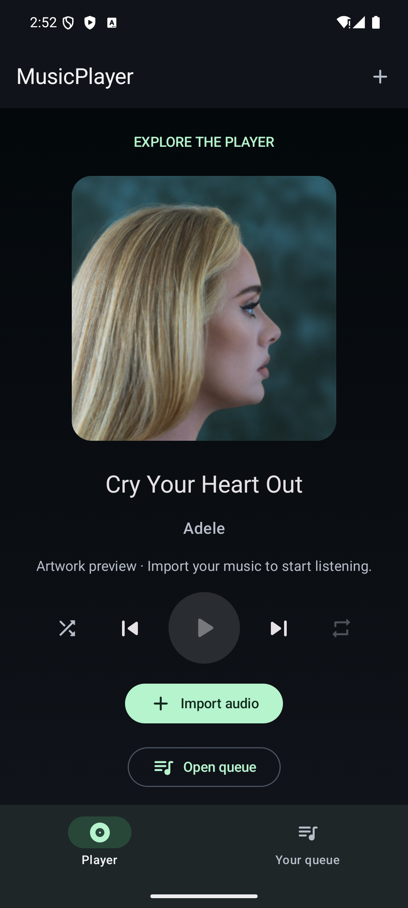
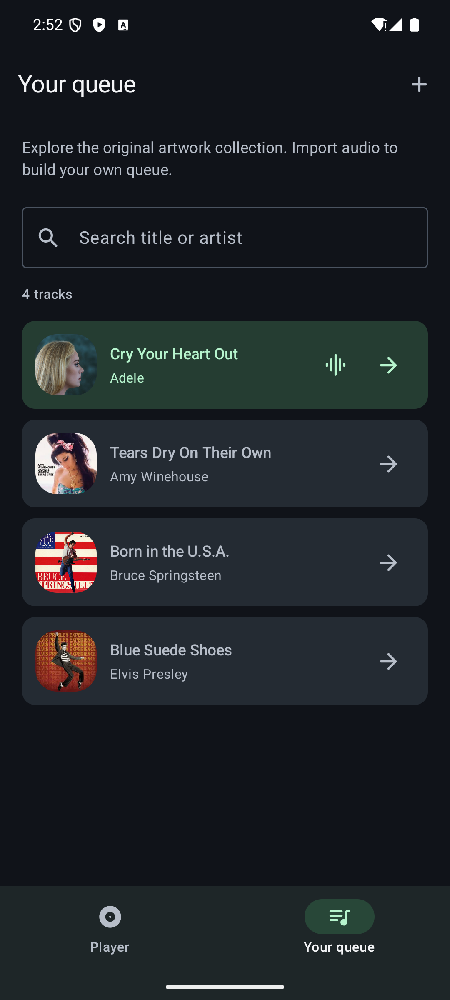

# MusicPlayerApp

**An Android music player for your own audio files**, built with Kotlin, Jetpack Compose and Media3.

Import tracks from your device, browse a searchable queue and keep listening while the app is in the background. The interface pairs album artwork with a matching dark gradient and provides playback controls inside the app and through Android's media notification.

**Author:** [Enri Sulejmani](https://github.com/EnriS2003) · **Platform:** Android 7.0+ · **Project type:** Personal learning and portfolio project

## Preview

<p>
  
  
</p>

*Screenshots captured on an Android 15 emulator. They show the initial artwork-preview catalogue; the commercial tracks pictured are not bundled as audio.*

## What you can do

- **Import your music:** select one or more audio files through Android's system document picker. The app reads available metadata and embedded cover artwork, with file-name and generic-cover fallbacks.
- **Control playback:** play, pause, seek, skip tracks, enable shuffle and choose repeat queue, repeat track or repeat off.
- **Keep listening in the background:** a Media3 session provides notification and lock-screen controls, audio focus handling and pause on headphone disconnection.
- **Browse your queue:** search by title or artist, select a track directly and open its details.
- **Keep a local library:** imported references and metadata persist across launches. Importing the same URI again does not add a duplicate; adding tracks preserves ongoing playback.
- **Manage imported tracks:** remove an entry from the library without deleting its original audio file.

Before the first import, four artwork-only examples let you explore the interface. Their Play button is disabled. Importing your first audio file replaces these previews with your own library; subsequent imports add to that library.

## Engineering decisions

This project explores the complete path from selecting a local file to controlling a background audio session.

| Decision | Why it matters |
| --- | --- |
| **One player owns the playback queue** | The UI observes the service's Media3 player instead of maintaining a separate playback index. Track selection stays consistent across shuffle, next/previous and notification controls. |
| **Playback lives in a `MediaSessionService`** | The audio engine is independent of the activity. Reconnecting the UI to an existing session preserves the current track and position. |
| **ViewModel and StateFlow drive Compose** | Screen state and playback actions are separated from reusable UI components. State collection follows the UI lifecycle. |
| **Track details use stable IDs** | Navigation does not depend on titles, artist names or descriptions, including text with slashes and special characters. |
| **File access uses the Storage Access Framework** | Users choose which files the app can read. Persistable URI grants support later access without requesting broad media-storage permissions. |
| **Artwork and import work run off the main thread** | Metadata extraction, cover decoding and palette generation avoid blocking UI rendering. |

The UI also handles system-bar insets, provides accessibility labels for playback controls and adapts the player and queue layouts for portrait and landscape use.

## Technology

| Area | Tools |
| --- | --- |
| Language | Kotlin 1.9.0 |
| UI | Jetpack Compose, Material 3, Navigation Compose |
| State | ViewModel, StateFlow, Kotlin coroutines |
| Audio | Media3 1.4.1, ExoPlayer, MediaSession |
| Artwork | Coil, AndroidX Palette |
| Local storage | SharedPreferences for catalogue metadata; app-private files for extracted artwork |
| Verification | JUnit, Compose UI tests, Android instrumentation tests, Android Lint |
| Build and CI | Gradle 8.7, Android Gradle Plugin 8.6.0, GitHub Actions |

## Run the app

### Requirements

- Android Studio compatible with Android Gradle Plugin 8.6.0.
- **JDK 17** for Gradle and **Android SDK Platform 35**.
- A device or emulator running **Android 7.0 / API 24** or later. The app targets API 35.

### Build and launch

```bash
git clone https://github.com/EnriS2003/MusicPlayerApp.git
cd MusicPlayerApp
./gradlew assembleDebug
```

Open the repository root in Android Studio, configure the SDK and Gradle JDK, select the `app` run configuration and launch it on your device or emulator. For command-line builds, set the SDK location through `local.properties` or `ANDROID_HOME`. On Windows, use `gradlew.bat`.

The debug APK is generated at `app/build/outputs/apk/debug/app-debug.apk`.

### Import and listen

1. Make an audio file available on the device. On an emulator, drag a file onto the emulator window to copy it into **Download**.
2. Tap **Import audio** or **+**, then select your file in the system picker. Multiple selections are supported.
3. Open **Your queue** and tap a track to start playback. Importing files does not start audio automatically.
4. Try the seek bar, shuffle and repeat controls, then put the app in the background to use Android's media controls.

No account or streaming service is required. Audio files remain in their original location and are not uploaded.

## Project structure

```text
app/src/main/java/com/example/musicplayerapp/
├── MainActivity.kt          # Activity, edge-to-edge setup and theme
├── data/                    # Track model, import, persistence and preview catalogue
├── playback/                # ExoPlayer service, session controller and preview selection
├── navigation/              # App scaffold, document picker, queue and track details
└── ui/
    ├── components/          # Artwork, transport controls and seek bar
    ├── player/              # Player screen, ViewModel and time formatting
    └── theme/               # Colours, typography and artwork-derived gradients
```

## Tests and checks

```bash
# Build, local unit tests and static analysis
./gradlew assembleDebug testDebugUnitTest lintDebug

# UI and playback integration tests; requires a running device or emulator
./gradlew connectedDebugAndroidTest
```

The current suite includes **6 unit tests** and **3 instrumented tests**:

- **Preview selection:** queue boundaries, random selection followed by next/previous, direct selection, single-item queues and invalid IDs.
- **Time formatting:** unknown durations, minute boundaries and hour-long audio.
- **Compose UI:** disabled playback for previews, the import action, queue search and selection by stable ID.
- **Playback integration:** real WAV decoding, shuffle-to-sequential navigation, seeking, queue appends, controller reconnection, removing the current track, clearing the queue, pause and continued playback in the background.

The playback integration test generates a silent WAV fixture; it does not depend on commercial music or a network stream.

These checks have passed locally on an **Android 15 / API 35 emulator**, including runs in portrait and landscape. Lint reports no errors; warnings remain for available dependency updates and unused legacy resources. Playback on physical devices still needs validation.

The [GitHub Actions workflow](.github/workflows/blank.yml) is configured to build the debug APK, run unit tests and lint, and upload reports and the APK. Instrumented tests are run separately with the command above.

## Scope and current limitations

This is a small local-file player with one imported library. It currently has no streaming integration, multiple saved playlists, metadata editor or playback resumption after the service/process stops. Format support depends on Media3 and the device's available decoders.

Library metadata and URI grants persist across launches. If a source file is moved or deleted, or its permission is revoked, playback may fail. The player displays an error; the entry can be removed and imported again. Extracted cover artwork is stored in app-private storage.

## Credits and licensing

The original artist and cover images are retained as prototype artwork. They are not accompanied by the pictured recordings, and their inclusion does not grant reuse rights. No open-source license has been added to this repository.

Implementation references: [Media3 background playback](https://developer.android.com/media/media3/session/background-playback) and [Android document access](https://developer.android.com/training/data-storage/shared/documents-files).
